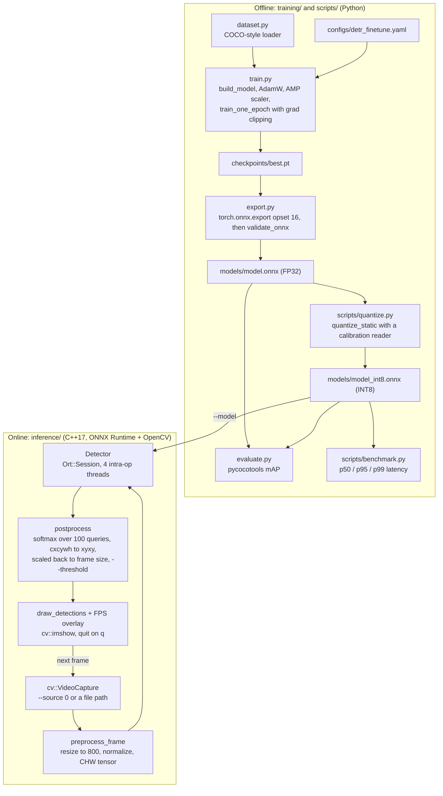
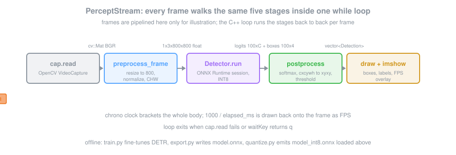

# Percept Stream

DETR fine-tuning pipeline with ONNX export, INT8 quantization, and a C++ ONNX Runtime inference application capable of 30+ FPS real-time detection.

## Overview

- **Fine-tune** `facebook/detr-resnet-50` on COCO-format dataset with mixed-precision training
- **Export** to ONNX FP32 via `torch.onnx.export`, validate PyTorch ↔ ONNX equivalence
- **Quantize** to INT8 with `onnxruntime.quantization.quantize_static` (static calibration)
- **C++ inference** with ONNX Runtime + OpenCV: preprocess → infer → postprocess → draw at 30+ FPS
- **Accuracy validation**: mAP@50 drop < 2% after INT8 quantization

## Tech Stack

Python 3.11 · PyTorch · HuggingFace Transformers · ONNX Runtime · C++17 · OpenCV · CMake

## Quickstart

```bash
# Python (training + export)
cd training && pip install -r requirements.txt
python src/train.py          # fine-tune DETR
python src/export.py         # export to ONNX
python scripts/quantize.py   # INT8 quantization
python scripts/benchmark.py  # verify <33ms latency

# C++ inference
mkdir inference/build && cd inference/build
cmake .. -DCMAKE_TOOLCHAIN_FILE=../../vcpkg/scripts/buildsystems/vcpkg.cmake
make -j$(nproc)
./detector --model ../models/model_int8.onnx --source 0
```

## Architecture



### Per-frame path



## Evaluation

The model is evaluated on the COCO val split (or the held-out split of the
fine-tuning dataset) using standard detection metrics.

### Detection metrics

Computed by `training/src/evaluate.py` via `pycocotools` over the validation
split listed in `training/configs/detr_finetune.yaml`:

- **mAP@[0.5:0.95]** — primary COCO metric, IoU averaged 0.5..0.95 step 0.05
- **mAP@0.5** — single-IoU mAP (lenient localization)
- **mAP@0.75** — strict-localization mAP
- **AP per class** and **AR@1 / AR@10 / AR@100**
- **Precision-recall curves** per class (saved as PNGs)

Run evaluation on a checkpoint:

```bash
python training/src/evaluate.py \
  --checkpoint training/checkpoints/best.pt \
  --config training/configs/detr_finetune.yaml \
  --split val
```

### Quantization quality gate

After INT8 export, compare FP32 vs INT8 on the same val split. The pass
criterion is **mAP@0.5 drop < 2 percentage points** and **mAP@[0.5:0.95]
drop < 1 pp**:

```bash
python training/src/evaluate.py --checkpoint models/model.onnx       --runtime ort
python training/src/evaluate.py --checkpoint models/model_int8.onnx  --runtime ort
```

### Runtime / latency

`scripts/benchmark.py` measures end-to-end inference latency on a fixed
batch of images using the ONNX Runtime session, reporting:

- **p50 / p95 / p99 latency** (ms per frame)
- **mean FPS** under sustained load
- **Throughput (images/sec)** at batch size 1 and 8

```bash
python scripts/benchmark.py --model models/model_int8.onnx --num-iters 500
```

Target: **>=30 FPS** end-to-end (preprocess + infer + postprocess) on the
deployment GPU/CPU; p99 < 33 ms.

### C++ inference correctness

`inference/tests/test_detector.cpp` (Google Test) checks preprocess/postprocess
parity with the Python pipeline on a small fixture set:

```bash
cd inference/build && ctest --output-on-failure
```

## Project Structure

```
percept_stream/
├── training/
│   ├── src/            # dataset.py, train.py, evaluate.py, export.py
│   └── configs/        # detr_finetune.yaml
├── inference/
│   ├── src/            # detector.cpp, preprocess.cpp, postprocess.cpp, main.cpp
│   ├── tests/          # Google Test suite
│   └── CMakeLists.txt
└── scripts/            # quantize.py, benchmark.py
```
